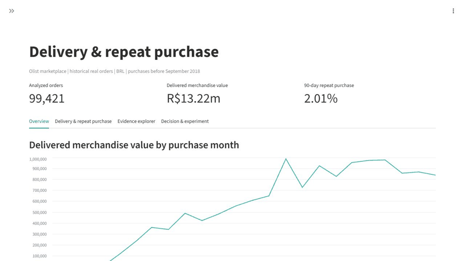

# Commerce Intelligence

**Late deliveries cut review scores almost in half, but across 70,000 customers there's no detectable hit to repeat purchases.**

[Live dashboard](https://dineshsatti90-commerce-intelligence.streamlit.app/) · [Two-minute walkthrough](docs/WALKTHROUGH.md) · [Run & methodology](docs/PROJECT_GUIDE.md)

- **Reviews collapse when orders are late:** 2.27 average stars versus 4.29 on time, across 99,421 analyzed orders. The pinned source release contains 99,441 orders; 99,421 precede the analysis cutoff.
- **Retention is a different story:** a timing-aware model puts the repeat-purchase difference at −0.16 points (95% CI −0.45 to +0.13). That rules out booking retention savings, but it doesn't prove delivery is harmless.
- **Where to act:** MA, CE and BA have the highest first-order late rates (18.4%, 16.5%, 13.9%). Fix operations there, then run a proper experiment on customer outcomes.

**AI layer:** an evidence copilot that only answers from reviewed SQL, with a scope gate that refuses anything the data can't support. [Evaluation, model comparison and failure analysis →](docs/AI_EVALUATION.md)

**SQL · Python · DuckDB · dbt · Streamlit**

[Decision memo](reports/decision_memo.md) · [Experiment design](reports/experiment_memo.md) · [Tests](tests) · [Method choices](docs/METHOD_CHOICES.md) · [Data terms](DATA_LICENSE.md) · [Limits](docs/PROJECT_GUIDE.md#limitations)
