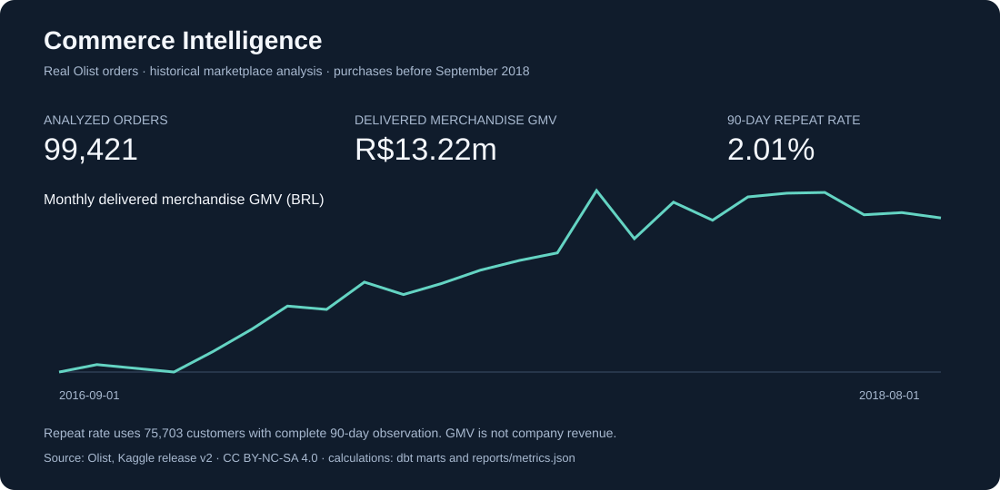
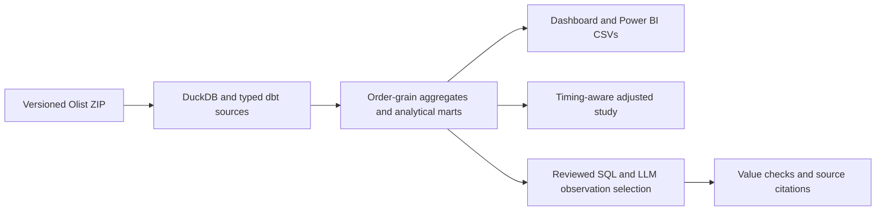

# Commerce Intelligence

[](https://github.com/Dineshsatti90/commerce-intelligence/actions/workflows/check.yml)

**Which delivery problems deserve action—and do the data support a retention business case?**

SQL/dbt analysis of 99,441 real Olist orders, a timing-aware repeat-purchase study and an evaluated, source-verified AI query router.

**Dashboard:** `streamlit run app.py` — runs on committed aggregates without a warehouse download.

## Three findings

1. **Delivery experience differs sharply:** mean review scores are 2.27 for late deliveries versus 4.29 on time.
2. **Retention savings are not established:** raw 90-day repeat rates are 1.77% after a late first order versus 2.03% on time. The timing-aware model estimates a −0.16 percentage-point difference on days 31–90, with a 95% interval of −0.44 to +0.12.
3. **Investigate MA, CE and BA first:** first-order late rates are 18.4%, 16.5% and 13.9% among states with at least 500 eligible customers. Pair operational remediation with a prospective customer-outcome experiment.



**Stack:** Python · SQL · DuckDB · dbt · Streamlit · statsmodels · optional local/API LLM.

[Decision memo](reports/decision_memo.md) · [Experiment design](reports/experiment_memo.md) · [State priorities](reports/state_delivery_priorities.csv)

## Measured AI performance

The copilot routes questions to six reviewed SQL queries, selects source observations and checks every cited value. It never executes model-written SQL. Offline mode runs the same catalog on committed aggregate extracts.

| Local Qwen 2.5 3B, 30 regression questions | Result |
| --- | ---: |
| Correct query/refusal routing | 86.7% |
| Correct route plus validated output/refusal | 50.0% |
| Refusal of 12 unsupported questions | 66.7% |

The initial prompt achieved only 43.3% routing. A revised prompt clarifies that the router retrieves existing data. Valid requests can still produce rejected values, and unsupported requests can be misrouted. This is an evaluated prototype. [Full run](reports/ai_evaluation.json) · [Examples and failures](docs/AI_EVALUATION.md) · [Initial run](eval/runs/qwen_initial.json).

## Run the demo

```bash
python -m venv .venv
# Windows: .venv/Scripts/Activate.ps1
# macOS/Linux: source .venv/bin/activate
python -m pip install -r requirements.txt
streamlit run app.py
```

## Rebuild the real-data analysis

```bash
python pipeline.py all
python analyze.py
python delivery_study.py
python make_overview.py
python -m pytest tests -q
```

The full pinned release includes 1,000,163 coordinate observations; those are not additional transactions. Activate the environment so `dbt` is on PATH. Model setup and `python copilot.py --evaluate` are documented in [operations](docs/OPERATIONS.md).

## Architecture and validation



CI runs committed Streamlit AppTests, metric tests and a **dbt build with 21 data tests on a labeled synthetic boundary fixture**. The fixture checks day-90/day-91 outcomes, immature cohorts, latest reviews and multi-item/payment fan-out. Real findings use the full Olist release. [Workflow](.github/workflows/check.yml) · [Tests](tests).

## Documentation

- [Data dictionary](docs/DATA_DICTIONARY.md), [methodology](docs/METHODOLOGY.md) and [operations](docs/OPERATIONS.md)
- [Power BI measures](bi/measures.dax); detailed order exports are generated locally
- [Source fingerprints](reports/source_manifest.json), [MIT code license](LICENSE) and [data terms](DATA_LICENSE.md)

## Limitations

Historical 2016–2018 snapshot; purchase cutoff 2018-09-01. Status is from the release, not an event-sourced historical state. First observed purchase may not be first-ever purchase. GMV is merchandise value, not platform revenue. The funnel measures fulfillment, not browsing. Delivery comparisons are observational; the day-30 landmark changes the population and cannot remove all confounding. Cohort charts hide groups below 100 customers by default; totals retain them. Seller IDs are anonymous and carrier identities are absent. The proposed experiment has not run. AI questions are a developer-visible regression set, not a held-out benchmark; value checking does not prove answer relevance. Public demos use recorded AI outputs unless explicitly configured. Native Power BI `.pbix` is not included.
