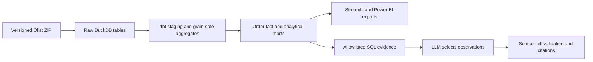

# Commerce Intelligence

[](https://github.com/Dineshsatti90/commerce-intelligence/actions/workflows/check.yml)

Marketplace analytics that connects delivery experience, repeat purchase and a prospective experiment decision using the complete public Olist release.

**Business question:** where should a marketplace investigate delivery experience and repeat purchase, and what should it test next?

**Stack:** Python · SQL · DuckDB · dbt · Streamlit · Power BI exports · optional OpenAI-compatible LLM.

## Results at a glance

| Observed measure | Result | Interpretation |
| --- | ---: | --- |
| Source orders | 99,441 | Complete version-2 order table |
| Orders in analysis window | 99,421 | Purchases before 1 September 2018 |
| Delivered merchandise GMV | R$13,221,498.11 | Item prices on delivered orders; not platform revenue |
| Customers with complete 90-day follow-up | 75,703 | First delivered purchase observed in the release |
| Customers purchasing again within 90 days | 1,519 / 2.01% | Repeat purchase, not contractual churn |
| Mean review score, on-time / late | 4.29 / 2.27 | Latest review per order; association, not a causal estimate |

**Decision:** investigate delivery experience with operations, then evaluate proactive delivery communication in a preregistered customer-level experiment. This analysis does not claim an intervention generated savings or uplift.

Real multi-table Olist data, a one-row-per-order warehouse, mature 90-day customer cohorts, a fulfillment funnel and an evidence-linked LLM interface. See [observed findings](reports/decision_memo.md) and [experiment proposal](reports/experiment_memo.md). Row counts and download hashes are in `reports/` after running.


## Quick start

Python 3.10+; Windows PowerShell (bash users substitute activation command):

```powershell
python -m venv .venv
.venv/Scripts/Activate.ps1
python -m pip install -r requirements.txt
python pipeline.py all
python analyze.py
python copilot.py --evaluate
python -m pytest tests -q
streamlit run app.py
```

On macOS/Linux, activate with `source .venv/bin/activate`. Run commands from the repository root. Internet is needed for initial package/data downloads; the analytical dashboard works locally after the pipeline completes. No API key is needed for the offline evidence explorer.

`requirements.lock.txt` records the exact environment used for the checked-in analysis. Install it instead of `requirements.txt` to reproduce those dependency versions.

`pipeline.py all` downloads the complete version-2 ZIP (~100k orders and 1m geolocation points; these are not 1m transactions), fingerprints files, ingests every CSV and executes `dbt build`. Downloading requires internet. Do not upload raw data, databases or credentials to GitHub. The original data license is separate from the code: see [Olist on Kaggle](https://www.kaggle.com/datasets/olistbr/brazilian-ecommerce), attributed to Olist, CC BY-NC-SA 4.0; verify source terms before redistribution or commercial reuse. Download URL is pinned to dataset version 2.

## Architecture



## Analytical contract

- Currency BRL; item price is merchandise GMV, not Olist revenue, profit or refunds. Freight and payment values remain separate.
- Payments and items aggregate independently before joining; latest review per order; ZIP points aggregate before joining. Tests reconcile order counts and delivered GMV to raw-grain controls.
- Historical cutoff: purchases before 2018-09-01; this deliberately avoids the tiny incomplete tail. Source status is snapshot status; this is not a historical as-of reconstruction of operations.
- Customer identity uses `customer_unique_id`, not the order-specific `customer_id`. Repeat purchase requires 90 full days of follow-up; no lifetime-value or contractual-churn claims.
- Cohorts begin at first purchase observed in this release, not necessarily a person's first-ever Olist purchase; the beginning of the source window is left-censored.
- No web events exist: the funnel is fulfillment timestamp completion, not visitor-to-checkout conversion. Categories can overlap orders; category counts are not additive.
- The experiment is prospective. CUPED code is supplied and tested, but the memo explains why zero pre-period spend for first-time customers makes CUPED unsuitable for that population.

## AI integration and evaluation status

Set `LLM_MODEL`, `LLM_BASE_URL` and, if needed, `LLM_API_KEY` in your shell; `.env.example` documents them, but `.env` is not auto-loaded. Any compatible JSON-mode chat endpoint can be configured, including a compatible local server. No provider key is bundled.

The model routes a question to six reviewed queries or refuses it. It does **not** execute free-form generated SQL. SQL owns all calculations; the model selects source cells; the renderer creates statements and row/column citations. Unexpected prose and altered numbers are rejected. This intentionally trades flexibility for auditability. It is constrained natural-language-to-query, not an unrestricted SQL agent.

Run `python copilot.py --evaluate` against 30 authored regression questions (18 supported, 12 unsupported including injection). The report records routing accuracy, end-to-end pass rate and failures. Without a model it explicitly records **not run**, never a fabricated score. This small developer-visible set is not an independent benchmark; extend it with unseen paraphrases before making general claims. Citation checking does not prove that the selected observation answers the user's question: human relevance review is still required.

## Power BI

Streamlit is the runnable dashboard. Import `reports/*.csv` into Power BI; `bi/measures.dax` contains starter measures. Use Overview, Delivery, Retention pages; show the observation window prominently. Marts remain separate aggregate tables; do not join them to order facts on month/state and accidentally duplicate results. A native `.pbix` is not included.

## Repository guide

| Location | Purpose |
| --- | --- |
| `pipeline.py` | Versioned download, SHA256 manifest, raw ingest and dbt execution |
| `dbt/models/staging/` | Typed source models |
| `dbt/models/intermediate/` | Order-level aggregates and unique ZIP dimensions |
| `dbt/models/marts/` | Order fact, retention, fulfillment, delivery and category marts |
| `analyze.py` | Observed-results exports, decision memo and experiment power calculation |
| `copilot.py` / `eval/` | Constrained model integration and 30-case evaluation harness |
| `app.py` / `bi/` | Interactive dashboard and Power BI measures |
| `reports/` | Reproducible findings, source manifest and aggregate extracts |
| `tests/` | Citation integrity, injection boundary and statistical utilities |

## Validation

The local reference run passed **21 dbt data tests** and **4 Python regression tests**. dbt checks unique identifiers, foreign keys, nonnegative values, cohort bounds, order grain and delivered-GMV reconciliation. Streamlit AppTest also exercised the dashboard and evidence selector. CI runs the small Python suite without downloading the dataset; a fresh full-data reproduction requires the pipeline command above.

The LLM evaluation is **not run until a model is configured**. The included 30 questions are a developer-authored regression set, not an independent performance benchmark. No model accuracy or time-saving claim is made.

## Documentation

- [Data dictionary and metric definitions](docs/DATA_DICTIONARY.md)
- [Methodology and analytical limitations](docs/METHODOLOGY.md)
- [Reproduction, AI configuration and troubleshooting](docs/OPERATIONS.md)
- [Observed-results decision memo](reports/decision_memo.md)
- [Prospective experiment design](reports/experiment_memo.md)
- [Data attribution and publication boundaries](DATA_LICENSE.md)
- [Contribution guide](CONTRIBUTING.md)

## Walkthrough

For a short review, follow the dashboard overview, mature repeat cohorts, delivery comparison, SQL evidence explorer and prospective experiment memo. Generated CSVs and source manifests make the findings inspectable without a hosted database. The results are historical observations; no realized savings or live experiment uplift is claimed.
