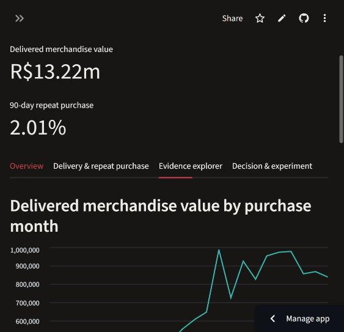
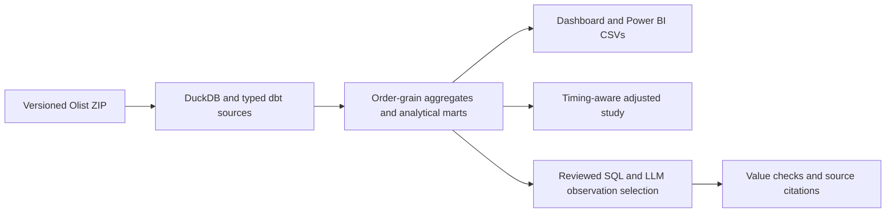

# Commerce Intelligence

[](https://github.com/Dineshsatti90/commerce-intelligence/actions/workflows/check.yml)

**Late deliveries have much worse review scores; a repeat-purchase association remains statistically uncertain.**

SQL/dbt analysis of 99,441 real Olist orders, a timing-aware repeat-purchase study and a separately evaluated AI evidence router.

**[Open the live dashboard](https://dineshsatti90-commerce-intelligence.streamlit.app/)**

## Three findings

1. **Delivery experience differs sharply:** mean review scores are 2.27 for late deliveries versus 4.29 on time.
2. **Retention savings are not established:** raw 90-day repeat rates are 1.77% after a late first order versus 2.03% on time. The timing-aware model estimates a −0.16 percentage-point difference on days 31–90, with a 95% interval of -0.45 to +0.13 points. This does not establish no effect.
3. **Investigate MA, CE and BA first:** first-order late rates are 18.4%, 16.5% and 13.9% among states with at least 500 eligible customers. Pair operational remediation with a prospective customer-outcome experiment.



**[Two-minute decision walkthrough](docs/WALKTHROUGH.md)** · [Method choices for interviews](docs/METHOD_CHOICES.md)

**Stack:** Python · SQL · DuckDB · dbt · Streamlit · statsmodels · optional local/API LLM.

[Decision memo](reports/decision_memo.md) · [Experiment design](reports/experiment_memo.md) · [State priorities](reports/state_delivery_priorities.csv)

## AI evaluation: source checks do not prove relevance

The copilot uses eight reviewed SQL queries, including SQL-computed monthly endpoints/peak and weighted retention summaries. Native JSON Schema constrains output structure; cited values are separately checked. The complete result table accompanies selected cells.

| Model | Set | N | Correct route | Route + source contract | Unsupported refusal | Wrong route with displayable cells |
| --- | --- | ---: | ---: | ---: | ---: | ---: |
| qwen2.5:3b | regression | 30 | 63% | 40% | 17% | 8 |
| qwen2.5:3b | fresh | 20 | 55% | 25% | 10% | 8 |
| llama3:8b | regression | 30 | 90% | 70% | 75% | 1 |
| llama3:8b | fresh | 20 | 90% | 80% | 90% | 2 |

The 20 fresh questions were frozen before these first-pass runs; the old 30 remain a developer-visible regression set. Both sets are developer-authored, not independent benchmarks. Schema mode did not improve every metric: the 3B model often failed to refuse unsupported questions. The 8B model did better but still produced displayable cells from wrong queries. **We do not claim zero incorrect answers.** The demo defaults to explicit query selection; configured free-text mode requires review and selection of the evidence scope before observations can be requested.

[Protocol, settings and failures](docs/AI_EVALUATION.md) · [Comparison](reports/model_comparison.json) · [Frozen questions](eval/fresh_questions.json) · [All recorded runs](eval/runs)

## What the delivery interval means

The on-time landmark day-31–90 baseline is 0.64%, not the roughly 2% full-window rate. A meaningful decline is still compatible with the interval. A separate independent two-proportion planning approximation, fixing these landmark group sizes and baseline, needs about **0.39 percentage points** of decrease for 80% power at two-sided 5% alpha. That is 60% relative to this low landmark baseline; it is not retrospective GLM power. [Design assumptions and memo](reports/decision_memo.md).

Free Community Cloud demos may sleep after inactivity; screenshots and the walkthrough remain available while they wake.

## Run the demo

```bash
python -m venv .venv
# Windows: .venv/Scripts/Activate.ps1
# macOS/Linux: source .venv/bin/activate
python -m pip install -r requirements.txt
streamlit run app.py
```

## Rebuild the real-data analysis

```bash
python pipeline.py all
python analyze.py
python delivery_study.py
python make_overview.py
python -m pytest tests -q
```

The full pinned release includes 1,000,163 coordinate observations; those are not additional transactions. Activate the environment so `dbt` is on PATH. Model setup and `python copilot.py --evaluate` are documented in [operations](docs/OPERATIONS.md).

## Architecture and validation



CI runs committed Streamlit AppTests, metric tests and a **dbt build with 21 data tests on a labeled synthetic boundary fixture**. The fixture checks day-90/day-91 outcomes, immature cohorts, latest reviews and multi-item/payment fan-out. Real findings use the full Olist release. [Workflow](.github/workflows/check.yml) · [Tests](tests).

## Documentation

- [Data dictionary](docs/DATA_DICTIONARY.md), [methodology](docs/METHODOLOGY.md) and [operations](docs/OPERATIONS.md)
- [Power BI measures](bi/measures.dax); detailed order exports are generated locally
- [Source fingerprints](reports/source_manifest.json), [MIT code license](LICENSE) and [data terms](DATA_LICENSE.md)

## Limitations

Historical 2016–2018 snapshot; purchase cutoff 2018-09-01. Status is from the release, not an event-sourced historical state. First observed purchase may not be first-ever purchase. GMV is merchandise value, not platform revenue. The funnel measures fulfillment, not browsing. Delivery comparisons are observational; the day-30 landmark changes the population and cannot remove all confounding. Cohort charts hide groups below 100 customers by default; totals retain them. Seller IDs are anonymous and carrier identities are absent. The proposed experiment has not run. AI questions are a developer-visible regression set, not a held-out benchmark; value checking does not prove answer relevance. Public demos use recorded AI outputs unless explicitly configured. Native Power BI `.pbix` is not included.
